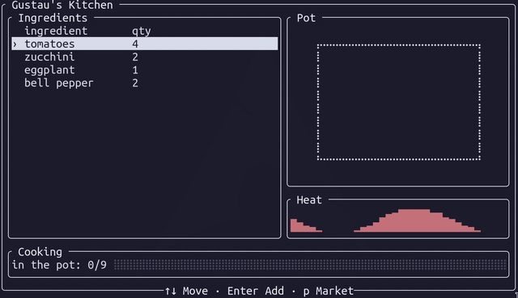

# Ratlings 🐀

Small, interactive exercises for learning [Ratatui](https://ratatui.rs),
powered by [Rustlings](https://rustlings.rust-lang.org).

> You are a rat learning to cook Ratatouille from Chef Gustau. Build one kitchen
> dashboard: choose ingredients from a table, add them to a pot, check the market
> date and watch the cooking progress!



## Getting started

Install Rustlings, clone this repository and start the exercises:

```bash
cargo install rustlings
git clone https://github.com/ratatui/ratlings
```

```bash
cd ratlings
rustlings
```

Rustlings opens the next unfinished exercise.

1. Edit the file it names in `exercises/`, fix the TODO and save it.
2. Follow the compiler feedback, then continue when Rustlings marks the exercise as complete.
3. Use `h` for a hint, `l` to list exercises, `c` to check all exercises, `x` to reset the current exercise and `q` to quit.

Each exercise adds one small piece to the same kitchen dashboard!

## Developing exercises

See [CONTRIBUTING.md](CONTRIBUTING.md).

```sh
rustlings dev update
rustlings dev check
```

## License

Licensed under the [MIT License](LICENSE).
